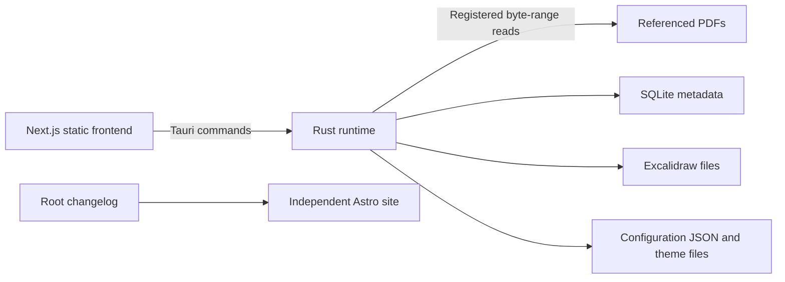

# Architecture

## Scope

Locus is a local desktop workspace for reading referenced PDFs and working on persistent Excalidraw drawings.
The public website is independent of the installed application. Planned capabilities are tracked separately in
[project direction](project-direction.md) and the [public roadmap](../website/src/pages/roadmap.astro).

## Units and ownership

| Unit               | Source scope                           | Responsibility                                                                     | Guide                                 |
| ------------------ | -------------------------------------- | ---------------------------------------------------------------------------------- | ------------------------------------- |
| Desktop frontend   | `packages/src-nextjs/`                 | React interface, panes, PDF rendering, drawing lifecycle, command dispatch         | [Frontend](packages/frontend.md)      |
| Native application | `packages/src-tauri/`                  | Window runtime, file picker, validated file access, SQLite and drawing persistence | [Native](packages/native.md)          |
| Public website     | `website/`                             | Landing page, public guides, plans, root changelog rendering                       | [Website](packages/website.md)        |
| Repository tooling | Root manifests, `scripts/`, `.github/` | Shared checks, commands, setup, CI and packaging                                   | [Getting started](getting-started.md) |

## Relationships

Next.js exports assets consumed by Tauri's WebView. Production does not run a Next.js server; local backend
operations belong in Rust. Browser development can display the interface but has no library/file backend.
The website is not an npm workspace and is not imported or bundled by the application.

## Representative flows

1. Attach a PDF: the frontend calls `attach_pdf`; Rust opens the native picker, validates the selected file,
   stores its reference, and returns a library snapshot. Cancellation produces no new attachment.
2. Read: PDF.js requests metadata and bounded byte ranges by registered document ID. Rust verifies the reference
   before reading. Missing or changed files produce explicit errors and require relinking.
3. Draw: a registered drawing ID identifies a portable Excalidraw file. Frontend saves are ordered per drawing;
   Rust validates and atomically replaces the file. Normal window closing flushes pending edits; a save failure
   prevents normal closing so the user can retry. Forced termination can still lose unsaved work.

## Contracts

| Producer              | Consumer              | Definition                                                                                                                                                      | Compatibility concern                                           |
| --------------------- | --------------------- | --------------------------------------------------------------------------------------------------------------------------------------------------------------- | --------------------------------------------------------------- |
| Rust command handlers | Frontend bridge       | [Handlers](../packages/src-tauri/src/lib.rs), [library bridge](../packages/src-nextjs/lib/library.ts), [drawing bridge](../packages/src-nextjs/lib/drawings.ts) | Keep names, serialized fields, IDs, units, and failures aligned |
| SQLite migrations     | Native library        | [Migrations](../packages/src-tauri/migrations/), [library](../packages/src-tauri/src/library.rs)                                                                | Preserve existing user data; reject unsupported newer schemas   |
| Next.js static export | Tauri bundler         | [Next config](../packages/src-nextjs/next.config.ts), [Tauri config](../packages/src-tauri/tauri.conf.json)                                                     | Frontend output path, asset availability, and CSP must agree    |
| Root changelog        | Astro changelog route | [Changelog](../CHANGELOG.md), [route](../website/src/pages/changelog.astro)                                                                                     | One source for user-visible release notes                       |

## Invariants and state

Rust owns library persistence and native file validation. Names and file paths are display/location metadata;
stable IDs identify records. Removing references does not delete original PDFs or authored drawing files.
[Storage](storage.md) owns the detailed schema, file layout, migrations, and removal semantics.

The frontend owns session pane layout, command registration, save queues, and theme application. Rust owns
versioned preference/key-binding files and validated theme loading; [Configuration](configuration.md) owns
paths, migration, and recovery. [Workbench](workbench.md) owns command scopes and pane behavior. One live editor per
whiteboard avoids competing writes inside the application. Concurrent external editing is not coordinated.

## Unresolved and unimplemented areas

PDF pins, Markdown editing, configurable note roots, managed relocation, and optional assistance remain planned.
Their schemas and compatibility contracts are not established by this document. Windows packaging and installed
Debian behavior require their own platform verification. See [release guidance](releasing.md).

See the [decision index](decisions/index.md) for the retrospectively recorded choices and their owner approval
evidence. Current implementation details remain in this guide and the package guides; accepted intent does not
imply that planned features or installed-platform behavior have been verified.
